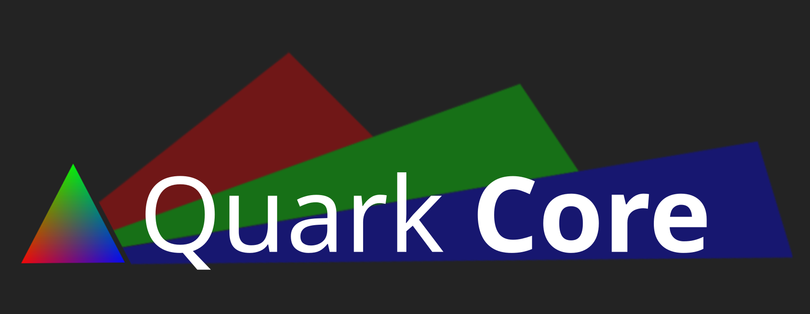

<div align="center">


<b>A rendering library built for the Quark Engine<br></b>

[](https://isocpp.org/)
[](https://www.opengl.org/)
[](https://www.vulkan.org/)
[](#license)

</div>

## Quick Start

### Requirements

- C++17 or later
- OpenGL 3.3 support for OpenGL backend
- Vulkan 1.2 support for Vulkan backend
- DirectX 11.1 support for DirectX 11 backend
- CMake 3.16+

For Windows GCC builds using MSYS2 UCRT64, install the Vulkan shader dependencies:

```bash
pacman -S --needed mingw-w64-ucrt-x86_64-assimp mingw-w64-ucrt-x86_64-glslang mingw-w64-ucrt-x86_64-shaderc mingw-w64-ucrt-x86_64-spirv-cross
```

### Installation

```bash
git clone https://github.com/Quark-Engine/QuarkCore.git
cd QuarkCore
cmake -B build -DCMAKE_BUILD_TYPE=Release
cmake --build build
```

---

## Usage

```cpp
#include "QuarkCore/QuarkCore.hpp"

int main()
{
    InitWindow(1280, 720, "Hello World");
    SetTargetFPS(60);

    while (!WindowShouldClose())
    {
        BeginDrawing();
        ClearBackground(Color{20, 24, 32, 255});

        DrawText("Hello, World!", 360, 340, 32, WHITE);

        EndDrawing();
    }

    CloseWindow();
    return 0;
}
```

---

<div align="center">

Made for the **[Quark Engine](https://github.com/Quark-Engine/QuarkEngine)**

</div>
